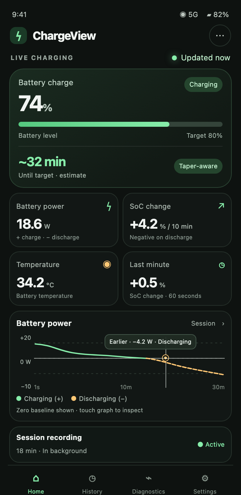
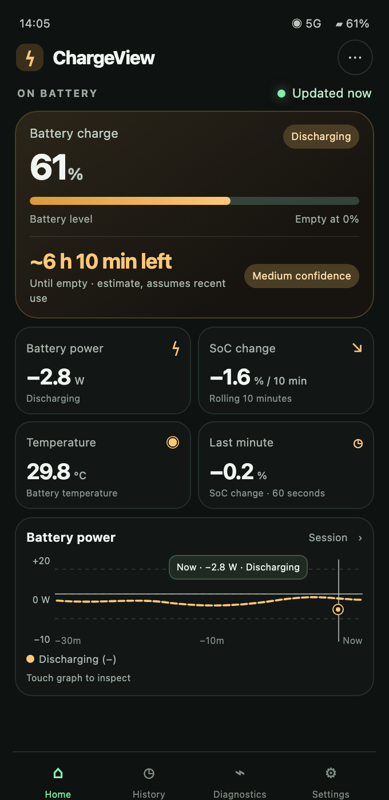
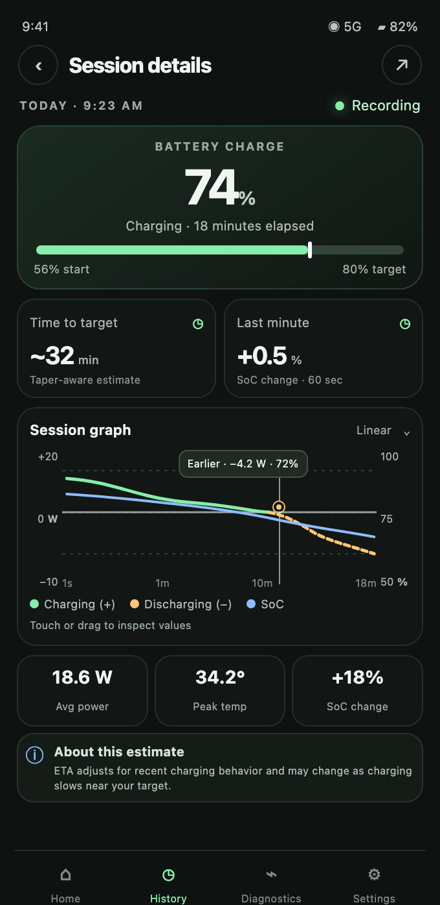
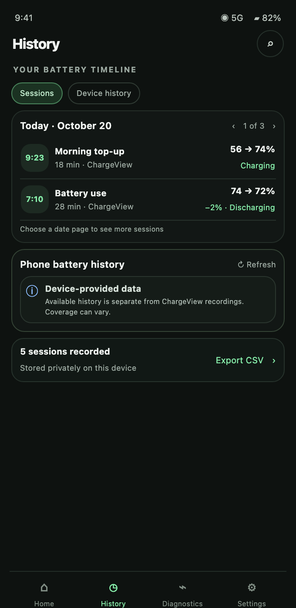
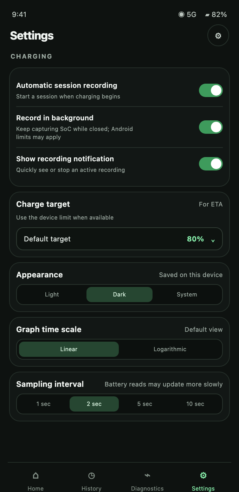

# ChargeView

[](https://github.com/Cohibastyle/ChargeView/actions/workflows/android-debug-apk.yml)
[](https://github.com/Cohibastyle/ChargeView/releases/latest)

A native Android battery monitor built with Kotlin and Jetpack Compose. ChargeView shows what your
battery is actually doing — live power, current, temperature, voltage and charge rate — and turns it
into plain-language estimates of how long until you're full or empty.

Everything is measured and stored on the device. No accounts, no network, no analytics.

## Download

Grab the latest debug APK from the [**latest release**](https://github.com/Cohibastyle/ChargeView/releases/latest)
and sideload it on an Android 8.0+ device. The release is rebuilt and replaced on every push to `main`.

## Screenshots

> These are rendered from the app's design mockups. They show the intended look and layout with
> sample readings.

| Dashboard (charging) | Dashboard (discharging) | Session detail |
| --- | --- | --- |
|  |  |  |

| History | Settings |
| --- | --- |
|  |  |

## Features

### Live dashboard
- Battery percentage, charging / discharging / idle state, and a taper-aware estimate of time to your
  charge target or time until empty.
- Signed battery power (W), current (mA), temperature (°C), voltage (V) and charge moved (mAh).
- SoC change since the last plug / unplug event, growing minute by minute up to a rolling 10 minutes.
- Large graph card with a labelled Y axis, touch inspection of individual samples, and a log-time axis
  with vertical interval lines (switchable to linear).
- Home scrolls, with the large top card pinned while the other cards and the graph move underneath.

### Configurable home cards
- Settings › Home screen cards toggles each card on or off: battery charge, power, SoC change,
  temperature, voltage, mAh rate & total, time, charge moved, next 1%, rate (%/hour) and energy (Wh),
  up to 8 at a time.
- Hold and drag a card on Home to reorder. The first card renders large with extra detail.
- Tapping a card plots that parameter in the large graph card.
- Every small card carries a last-10-minute trend line.

### Estimates that don't jump around
- Time to target / empty is derived from SoC step timings over a 20-minute window (SoC is reported in
  whole numbers), falling back to 5-minute smoothed current — so brief spikes don't swing the result.
- Confidence and low/high bounds are shown alongside the estimate.

### History
- Recorded sessions with start/end level, direction and peak power, plus a level graph.
- Paged browsing of recorded samples, stored locally as CSV.

### Diagnostics
- Raw readings, system load estimate, and top apps by screen time (with an optional usage-access
  grant) to help explain what drained the battery.

### Settings
- Light / Dark / Follow system theme.
- Charge target, update interval (0.1s to 60s), battery capacity override (automatic or manual),
  recording on/off, clear history, and a How to use ChargeView manual.

### Responsive
- Adapts in place to the Galaxy Fold7 cover and unfolded screens, and to rotation, without a restart.

## Not yet implemented
- Background (foreground-service) recording — readings are recorded only while the app is running.
- CSV export and device-provided history import.

## Build

Requirements: JDK 17 and the Android SDK (platform 35).

```bash
gradle wrapper --gradle-version 8.10.2
./gradlew assembleDebug
```

The APK lands at `app/build/outputs/apk/debug/app-debug.apk`. The GitHub Actions workflow in
[`.github/workflows/android-debug-apk.yml`](.github/workflows/android-debug-apk.yml) builds the same
APK on every push to `main` / `master` and on pull requests, uploads it as the
`chargeview-debug-apk` artifact, and on pushes to `main` / `master` also publishes it to the
[`latest` release](https://github.com/Cohibastyle/ChargeView/releases/latest).

## Project layout

| Path | Contents |
| --- | --- |
| `app/src/main/java/com/chargeview/app/MainActivity.kt` | Activity entry point and Compose host |
| `app/src/main/java/com/chargeview/app/Ui.kt` | Screens, theme, cards and shared UI |
| `app/src/main/java/com/chargeview/app/Cards.kt` | Home card rendering and reordering |
| `app/src/main/java/com/chargeview/app/Charts.kt` | Graph drawing and touch inspection |
| `app/src/main/java/com/chargeview/app/BatteryViewModel.kt` | Polling, recording, persistence, settings |
| `app/src/main/java/com/chargeview/app/Model.kt` | `Sample`, `Session`, `CardId`, `Estimator` |
| `app/src/main/java/com/chargeview/app/AppUsage.kt` | Per-app screen-time estimates |

## Data and privacy

Readings are appended to a CSV file in the app's private storage (`history.csv`, capped at the most
recent 20,000 samples) and are never uploaded. Clearing history in Settings deletes the file.

## Documentation

- [FSD.md](FSD.md) — functional specification.
